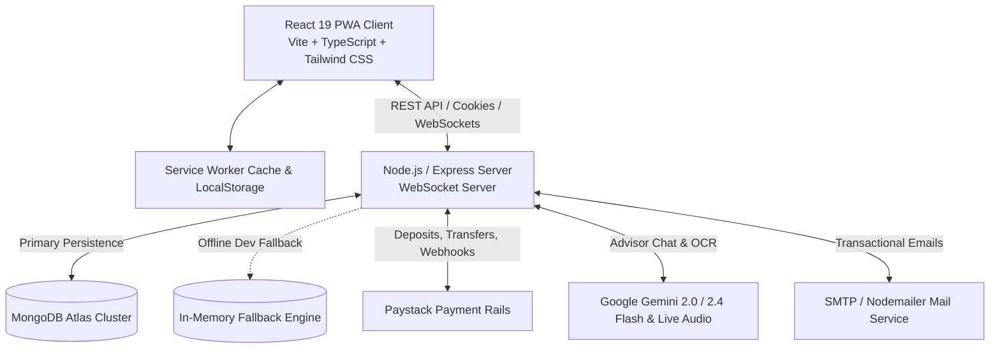
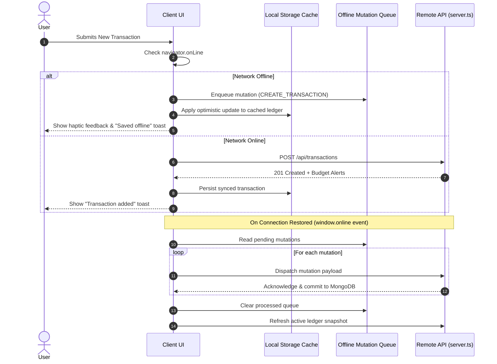

# 📘 FIMARA FINANCIAL MANAGER — COMPLETE SYSTEM ARCHITECTURE & USER DOCUMENTATION
**Version:** 1.6.5 (Production Release)  
**Classification:** Technical Architecture, API Specification, Security Whitepaper & Operation Manual  
**Repository:** `Finance_Manager-main`  
**Target Runtimes:** Progressive Web App (PWA), Android (TWA / Play Store), Desktop & Modern Web Browsers  

---

## 📋 TABLE OF CONTENTS
1. [Executive Summary & Product Vision](#1-executive-summary--product-vision)
2. [High-Level Architecture & Technology Stack](#2-high-level-architecture--technology-stack)
3. [Bank-Grade Security, Auth & Privacy Infrastructure](#3-bank-grade-security-auth--privacy-infrastructure)
4. [Offline-First Resilience & Mutation Sync Engine](#4-offline-first-resilience--mutation-sync-engine)
5. [Core Functional Modules](#5-core-functional-modules)
   - 5.1 [Multi-Profile & Multi-Currency Engine](#51-multi-profile--multi-currency-engine)
   - 5.2 [Smart Budget Velocity & 80% Pacing Engine](#52-smart-budget-velocity--80-pacing-engine)
   - 5.3 [Transaction Ledger & Export System](#53-transaction-ledger--export-system)
   - 5.4 [MoMo SMS & Receipt OCR Auto-Parser](#54-momo-sms--receipt-ocr-auto-parser)
   - 5.5 [Savings Vaults, Goals & Paystack Rails](#55-savings-vaults-goals--paystack-rails)
   - 5.6 [Debt & Peer-to-Peer Lending Tracker](#56-debt--peer-to-peer-lending-tracker)
   - 5.7 [Monthly History & Automatic Rollover](#57-monthly-history--automatic-rollover)
   - 5.8 [Gemini AI Financial Advisor & Spoken Audio](#58-gemini-ai-financial-advisor--spoken-audio)
   - 5.9 [Financial Reports, Analytics & PDF Generation](#59-financial-reports-analytics--pdf-generation)
   - 5.10 [Administrative God Mode & Governance](#510-administrative-god-mode--governance)
6. [Data Models & Schema Specifications](#6-data-models--schema-specifications)
7. [REST & WebSocket API Reference](#7-rest--websocket-api-reference)
8. [Configuration & Environment Variables](#8-configuration--environment-variables)
9. [Deployment & PWA / Android Play Store Guide](#9-deployment--pwa--android-play-store-guide)
10. [Troubleshooting & Operational Runbook](#10-troubleshooting--operational-runbook)

---

## 1. EXECUTIVE SUMMARY & PRODUCT VISION

**Fimara** (formerly Ledger Financial Manager) is an institutional-grade, privacy-first personal and entity financial management platform. Engineered to mirror the resilience, security, and fluid user experience of tier-1 private wealth applications (such as Ecobank Private Wealth, Revolut, and Monzo), Fimara eliminates the common pitfalls of modern cloud fintech apps: network fragility, privacy invasion, and slow manual data entry.

### Core Value Pillars
1. **100% Offline-First Ledger**: Users can record transactions, adjust budgets, track debts, and inspect balances without active mobile data or Wi-Fi. All changes queue locally and automatically reconcile upon reconnection.
2. **Bank-Grade Mobile Security**: Non-destructive session timeouts, WebAuthn biometrics (Touch ID / Face ID / Windows Hello), a 4-digit PBKDF2 local passcode, and an App Switcher Privacy Shield that obscures balances from mobile screen previewers.
3. **Smart Budget Velocity & Pacing Analytics**: Unlike static budget bars, Fimara calculates daily burn rates, compares calendar progress against financial outflow, provides 80% threshold warnings, and projects exhaustion dates.
4. **Frictionless Ingestion**: Built-in MoMo (Mobile Money) SMS alert parser and receipt OCR parsing instantly extract merchant names, amounts, and expense categories in one tap.
5. **Pan-African & Global Financial Rails**: Native support for West African payment rails (MTN Mobile Money, Telecel Cash, AT Money, Nigerian & Ghanaian commercial banks via Paystack) paired with multi-currency forex revaluations (GHS, USD, EUR, GBP, NGN).

---

## 2. HIGH-LEVEL ARCHITECTURE & TECHNOLOGY STACK



### Front-End Architecture
- **Framework**: React 19 (`react`, `react-dom`) with strict TypeScript (`5.8.2`).
- **Styling & Design System**: Tailwind CSS v4 (`@tailwindcss/vite`), custom CSS tokens in `foundation.css` featuring strict light/dark theme variables, iOS fluid typography, and glassmorphism.
- **Iconography & Motion**: Lucide React (`lucide-react`), Framer Motion (`motion`).
- **Data Visualizations**: Recharts (`recharts`) and KaTeX math formatting (`katex`).
- **PWA & Mobile Layer**: Web App Manifest (`manifest.webmanifest`), Service Worker cache, Android Trusted Web Activity (TWA) Digital Asset Links (`.well-known/assetlinks.json`), HTML5 Haptic Vibration API.

### Back-End Architecture
- **Runtime**: Node.js (`>=22.12.0`), TypeScript (`tsx`), bundled via `esbuild`.
- **API Framework**: Express 4.21 with strict security headers (`X-Content-Type-Options`, `X-Frame-Options`, `X-XSS-Protection`, `Referrer-Policy`, strict CORS credentials).
- **Real-Time Communication**: WebSocket Server (`ws`) for bidirectional low-latency AI advisor voice streaming.
- **Database Engine**: Dual-mode storage manager (`server/db.ts`):
  - *Production*: MongoDB Atlas via official Node driver (`mongodb ^7.6.0`).
  - *Development / Zero-Config*: Automated In-Memory Collection Engine with thread-safe UUID generation and schema indexing.

---

## 3. BANK-GRADE SECURITY, AUTH & PRIVACY INFRASTRUCTURE

Fimara implements a defense-in-depth security model engineered according to banking regulatory standards.

### 3.1 Authentication & Session Management
- **JWT (JSON Web Tokens)**: Cryptographically signed via `HS256` using `JWT_SECRET`. Tokens are transported exclusively inside `HttpOnly`, `SameSite=Lax`, `Secure` cookies (`COOKIE_NAME = 'ledger_session'`), completely eliminating token theft via cross-site scripting (XSS).
- **Password Hashing**: Industry-standard `bcryptjs` with 10 salt rounds.
- **Rate Limiting & Brute Force Lockout**: Dedicated sliding window rate limiter (`server/auth.ts`). Failed attempts trigger progressive delays: 5 failed attempts locks the IP/user identifier for 15 minutes.
- **Stealth Admin Authentication**: Dual-layer authorization separating standard users from system administrators. Admin endpoints verify role integrity on every request; stealth admin mode allows emergency platform intervention via `ADMIN_SECRET_KEY`.

### 3.2 Non-Destructive Inactivity Lock (Bank-Grade Auto-Lock)
- Unlike basic web apps that abruptly log out the user and destroy draft input upon timing out, Fimara uses an in-app security lock (`src/services/sessionLock.ts` and `src/context/AuthContext.tsx`).
- **Configurable Timeouts**:
  - `immediate`: Locks immediately when the app is minimized or the tab loses focus.
  - `1min`, `5min`, `15min`, `30min`: Locks after inactive countdown.
  - `never`: Locks only upon manual click or app reboot.
- **Quick Re-Authentication**: Unlocking requires biometric touch or the 4-digit offline PIN. Unlocking instantly restores user state, unsaved drafts, and form inputs.

### 3.3 App Switcher Privacy Shield
- When mobile users switch between apps, mobile operating systems (iOS and Android) capture a background snapshot for the application carousel.
- Fimara listens to `document.visibilitychange` and window `blur` events. If the user backgrounds the application, an instant frosted glass overlay (`bg-canvas/90 backdrop-blur-2xl z-9999`) covers the viewport, preventing passersby or screenshot scrapers from viewing sensitive account balances.

### 3.4 4-Digit Offline Passcode Security
- Located in `src/services/offlinePinAuth.ts`.
- Allows users to securely unlock and inspect their cached ledger on mobile devices when out of cellular service or Wi-Fi range.
- Hashes the PIN using salted SHA-256 before storing it in local browser storage.
- Dispatches an asynchronous email backup confirmation to the user upon configuration.

### 3.5 WebAuthn Biometric Authentication
- Native biometric authentication (`src/services/biometrics.ts`) leveraging the W3C Web Authentication standard (`navigator.credentials.create` and `navigator.credentials.get`).
- Enables Face ID, Touch ID, Android BiometricPrompt, and Windows Hello for instant, passwordless app unlock.

---

## 4. OFFLINE-FIRST RESILIENCE & MUTATION SYNC ENGINE

Fimara is architected so that network disruption never halts financial management.



### Key Offline Services
1. `src/services/offlineSync.ts`:
   - Enqueues atomic mutations (`CREATE_TRANSACTION`, `UPDATE_TRANSACTION`, `DELETE_TRANSACTION`).
   - Maintains an optimistic cache per profile in `localStorage`.
   - Binds to browser `'online'` and `'offline'` events to seamlessly flush queues without user intervention.
2. `src/components/common/NetworkStatusBanner.tsx`:
   - Non-intrusive status pill indicating live sync status, pending item counts, and network health.

---

## 5. CORE FUNCTIONAL MODULES

### 5.1 Multi-Profile & Multi-Currency Engine
- **Entity Isolation**: Supports multiple independent profiles under a single user account:
  - `personal`: Everyday personal expenses.
  - `business`: Commercial sales, inventory, payroll, operational expenses.
  - `family`: Shared household grocery, utility, and tuition tracking.
  - `savings`: Dedicated holding and wealth accumulation entity.
- **Profile-Level PIN Locks**: Profiles can be individually locked with dedicated PINs to safeguard business or private ledgers when sharing devices.
- **Forex Revaluation**:
  - Profiles support unique base currencies (`GHS`, `USD`, `EUR`, `GBP`, `NGN`).
  - Exchange rates are centrally managed by administrators and converted dynamically across transactions and summary cards.

### 5.2 Smart Budget Velocity & 80% Pacing Engine
Located in `src/services/budgetVelocity.ts`, `src/pages/BudgetsPage.tsx`, and `src/components/overview/BudgetMonitor.tsx`.

#### Velocity Mathematical Model
Traditional budgeting apps only show a linear percentage ($Spent / Limit$). Fimara evaluates spending in relation to the **calendar day of the month**:

$$\text{Calendar Progress (\%)} = \left(\frac{\text{Current Day}}{\text{Total Days in Month}}\right) \times 100$$

$$\text{Burn Velocity Ratio} = \frac{\text{Budget Spent Percentage}}{\max(1, \text{Calendar Progress Percentage})}$$

$$\text{Safe Daily Allowance} = \frac{\max(0, \text{Budget Limit} - \text{Total Spent})}{\max(1, \text{Days Remaining in Month})}$$

#### System Behavioral Responses:
- **Pacing Fast (Velocity $\ge 1.25$)**: If a user is consuming budget 25% faster than the calendar pace, a warning tag (`🔥 Pacing fast (1.4x)`) appears, along with an alert projecting exhaustion date (e.g., *"Burn pace projects limit exhaustion around day 18"*).
- **80% Threshold Warning**: Triggers when expenditure reaches or crosses 80% of limit before month-end, advising immediate austerity.
- **105% Hard Lockout**: When a budget exceeds 105%, the category automatically switches to `exceeded_locked` status to prevent catastrophic budget blowout.

### 5.3 Transaction Ledger & Export System
- Filter by transaction type (`income`, `expense`), custom date range, search query, or category.
- Full support for recurring frequency rules (`none`, `weekly`, `monthly`).
- Numeric keypad optimization (`inputMode="decimal"`) ensures mobile keyboards open directly to the numbers and decimal point.
- **Export Formats**: Instant client-side generation of `.csv` and `.xlsx` spreadsheets formatted for accounting software.

### 5.4 MoMo SMS & Receipt OCR Auto-Parser
Located in `src/services/momoParser.ts` and `src/components/Modals/SmartParserModal.tsx`.
- **Telco Support**:
  - MTN Mobile Money (Ghana, Nigeria, West Africa)
  - Telecel Cash (formerly Vodafone Cash)
  - AT Money (AirtelTigo)
  - Bank SMS transfer alerts (Ecobank, GCB, Stanbic, Zenith, GTBank)
- **OCR Receipt Ingestion**: Accepts photo uploads or camera snapshots of paper receipts. Extracts merchant names, transaction timestamps, items, and total payment amounts via regex and Google Gemini Flash vision parsing.

### 5.5 Savings Vaults, Goals & Paystack Rails
Located in `src/pages/GoalsPage.tsx` and `server/services/paystack.ts`.
- **Vault Types**:
  - `high_yield_vault`: Fixed-return interest-bearing account.
  - `locked_savings`: Time-locked safe with designated maturity date.
  - `emergency_stash`: Flexible access cushion.
  - `flexible_goal`: Target-driven progress vault.
- **Paystack Payment Integration**:
  - Deposits initialized directly via Paystack inline popup or redirect.
  - Real-time webhook listener (`/api/paystack/webhook`) verified via HMAC SHA-512 signatures (`x-paystack-signature`).
  - Automatic fund attribution to vault targets.
- **Withdrawal Governance & Penalty Engine**:
  - Standard withdrawal fee: 2%.
  - Early withdrawal penalty: 10% penalty fee applied if funds are broken before maturity.
  - Complete administrative audit trail for payouts to mobile money numbers or commercial bank accounts.

### 5.6 Debt & Peer-to-Peer Lending Tracker
Located in `src/pages/DebtsPage.tsx`.
- Tracks two directional flows:
  - `i_owe`: Liabilities, borrowed funds, vendor invoices due.
  - `owed_to_me`: Assets, loans given to friends, outstanding client retainers.
- Features installment tracking, partial settlement, due date notifications, and net debt balance calculation.

### 5.7 Monthly History & Automatic Rollover
Located in `src/pages/HistoryPage.tsx`.
- **Auto-Rollover**: On the 1st of each month, the dashboard net balance automatically rolls over to 0.00 for a fresh cycle while preserving lifetime history.
- **Monthly Snapshots**: Summarizes total inflows, outflows, savings rates, and category rankings for every historical month.
- **Manual Cycle Reset**: Users can reset active cashflow counters at any time without deleting underlying ledger transactions.

### 5.8 Gemini AI Financial Advisor & Spoken Audio
Located in `src/pages/AIAdvisorPage.tsx`, `src/components/SpatialVoiceOrb.tsx`, and `server/services/gemini.ts`.
- **Intelligent Advisor**: Grounded in the user’s real-time financial ledger (balances, budgets, velocity, debts). Provides tactical spending analysis, debt pay-off plans (Avalanche vs. Snowball), and tax estimations.
- **Rate-Limiting Quotas**: Protected by a sliding 40-message quota window over 8 hours to prevent API abuse and cost overruns.
- **Live Spoken Audio Orb**: Real-time bi-directional voice streaming via WebSocket (`/api/gemini/live-voice`) allowing hands-free spoken consultations.

### 5.9 Financial Reports, Analytics & PDF Generation
Located in `src/pages/ReportsPage.tsx` and `src/utils/exportReports.ts`.
- Visual cashflow velocity, income vs. expense bar charts, category distribution donuts.
- **Institutional PDF Statement Generation**: Uses `jspdf` to create formal, branded financial statements suitable for visa applications, mortgage checks, or business audits.

### 5.10 Administrative God Mode & Governance
Located in `src/pages/AdminPage.tsx` and `src/components/Modals/AdminGodModeModal.tsx`.
- Platform-wide telemetry: active users, total profiles, system-wide transaction volume, aggregate vault holdings, fee revenue.
- User management: inspect profiles, reset credentials, promote/demote roles.
- Withdrawal processing: approve or reject vault liquidation requests with automated audit logging.

---

## 6. DATA MODELS & SCHEMA SPECIFICATIONS

### Profile Entity
```typescript
interface Profile {
  id: string;
  userId?: string;
  name: string;
  color: string;
  displayCurrency: 'GHS' | 'USD' | 'EUR' | 'GBP' | 'NGN' | string;
  exchangeRates: Record<string, number>;
  type?: 'personal' | 'family' | 'business' | 'savings';
  isLocked?: boolean;
  balanceResetAt?: string;
  balanceResetAmount?: number;
  autoMonthlyReset?: boolean;
  createdAt: string;
}
```

### Transaction Entity
```typescript
interface Transaction {
  id: string;
  profileId: string;
  type: 'income' | 'expense';
  amount: number;
  currency: string;
  category: string;
  date: string; // ISO 8601 (YYYY-MM-DD)
  note: string;
  recurring: 'none' | 'weekly' | 'monthly';
  createdAt: string;
  pendingSync?: boolean;
}
```

### Budget Entity
```typescript
interface Budget {
  id: string;
  profileId: string;
  category: string;
  limit: number;
  currency: string;
  spent?: number;
  percentage?: number;
  remaining?: number;
  rawSpent?: number;
  cappedSpent?: number;
  isExceeded?: boolean;
  status?: 'normal' | 'exceeded_locked';
}
```

### Goal / Vault Entity
```typescript
interface Goal {
  id: string;
  profileId: string;
  name: string;
  target: number;
  current: number;
  currency: string;
  deadline?: string;
  status?: 'active' | 'pending_withdrawal' | 'withdrawn' | 'locked';
  vaultType?: 'high_yield_vault' | 'locked_savings' | 'emergency_stash' | 'flexible_goal';
  interestRateApr?: number;
  isLocked?: boolean;
  lockPeriodDays?: number;
  paystackDestination: {
    type: 'paystack_recipient' | 'none';
    recipientCode?: string;
    accountLast4?: string;
    bankName?: string;
    bankCode?: string;
    accountName?: string;
    accountNumber?: string;
  };
  createdAt: string;
}
```

---

## 7. REST & WEBSOCKET API REFERENCE

All authenticated requests require the `ledger_session` HTTP-only cookie.

### Authentication Endpoints
| Method | Endpoint | Description | Auth Required |
| :--- | :--- | :--- | :--- |
| `POST` | `/api/auth/register` | Create user account | No |
| `POST` | `/api/auth/login` | Sign in & receive session cookie | No |
| `POST` | `/api/auth/google` | Sign in / register via Google OAuth | No |
| `POST` | `/api/auth/logout` | Clear session cookie | Yes |
| `GET` | `/api/auth/me` | Fetch active user credentials | Yes |
| `POST` | `/api/auth/forgot-password` | Request password reset verification code | No |
| `POST` | `/api/auth/reset-password` | Set new password with verified token | No |
| `POST` | `/api/auth/offline-pin` | Save & email-backup 4-digit offline PIN | Yes |
| `POST` | `/api/auth/verify-pin` | Verify owner security PIN | Yes |

### Ledger & Entity Endpoints
| Method | Endpoint | Description | Auth Required |
| :--- | :--- | :--- | :--- |
| `GET` | `/api/profiles` | List user profiles | Yes |
| `POST` | `/api/profiles` | Create profile entity | Yes |
| `PUT` | `/api/profiles/:id` | Update profile settings/currency | Yes |
| `POST` | `/api/profiles/:id/reset-balance` | Reset active cycle net balance | Yes |
| `GET` | `/api/summary` | Get computed balance & velocity stats | Yes |
| `GET` | `/api/transactions` | Query ledger transactions | Yes |
| `POST` | `/api/transactions` | Record transaction (checks budget) | Yes |
| `PUT` | `/api/transactions/:id` | Modify transaction | Yes |
| `DELETE` | `/api/transactions/:id` | Delete transaction | Yes |
| `GET` | `/api/budgets` | List budgets & category spend | Yes |
| `POST` | `/api/budgets` | Set category limit | Yes |
| `DELETE` | `/api/budgets/:id` | Delete budget limit | Yes |
| `GET` | `/api/goals` | List savings vaults | Yes |
| `POST` | `/api/goals` | Create savings vault | Yes |
| `POST` | `/api/goals/:id/withdraw` | Request vault liquidation | Yes |
| `GET` | `/api/debts` | List liabilities and receivables | Yes |
| `POST` | `/api/debts` | Create debt record | Yes |
| `PUT` | `/api/debts/:id` | Update settlement status | Yes |
| `DELETE` | `/api/debts/:id` | Delete debt record | Yes |

### Paystack & AI Webhooks
| Method | Endpoint | Description | Auth Required |
| :--- | :--- | :--- | :--- |
| `POST` | `/api/paystack/initialize-deposit` | Initialize deposit to vault | Yes |
| `GET` | `/api/paystack/verify/:reference` | Verify deposit transaction | Yes |
| `POST` | `/api/paystack/webhook` | Webhook receiver (HMAC verified) | Signature |
| `POST` | `/api/ai/chat` | Query Gemini financial advisor | Yes |
| `POST` | `/api/ai/parse-transaction` | Parse receipt / MoMo text via AI | Yes |
| `WS` | `/api/gemini/live-voice` | Low-latency full-duplex voice stream | Yes |

---

## 8. CONFIGURATION & ENVIRONMENT VARIABLES

Store these values in `.env` (or cloud secrets in Render, Fly, or Docker):

```ini
# ==============================================================================
# DATABASE PERSISTENCE
# ==============================================================================
# MongoDB Atlas URI (Falls back to In-Memory if omitted)
MONGODB_URI=mongodb+srv://<user>:<password>@cluster0.abcde.mongodb.net/ledger?retryWrites=true&w=majority

# ==============================================================================
# SECURITY & AUTHENTICATION
# ==============================================================================
# Cryptographic secret for signing JWT cookies (MANDATORY in production)
JWT_SECRET=super_secret_cryptographic_key_at_least_32_chars

# Stealth admin key for emergency platform access
ADMIN_SECRET_KEY=stealth_master_key_998811

# Bcrypt hash for 4-6 digit master security PIN
APP_PIN_HASH=$2a$10$abcdefghijklmnopqrstuvwxyz0123456789

# Cookie name (defaults to ledger_session)
SESSION_COOKIE_NAME=ledger_session

# ==============================================================================
# PAYMENT RAILS (PAYSTACK GHANA / NIGERIA)
# ==============================================================================
PAYSTACK_SECRET_KEY=your_paystack_secret_key_here
PAYSTACK_PUBLIC_KEY=your_paystack_public_key_here
PAYSTACK_WEBHOOK_SECRET=your_paystack_webhook_secret_here

# ==============================================================================
# GOOGLE GEMINI AI
# ==============================================================================
GEMINI_API_KEY=your_gemini_api_key_here

# ==============================================================================
# TRANSACTIONAL EMAIL (NODEMAILER / SMTP)
# ==============================================================================
SMTP_HOST=smtp.gmail.com
SMTP_PORT=587
SMTP_SECURE=false
SMTP_USER=support@fimara.app
SMTP_PASS=xxxx-xxxx-xxxx-xxxx
SMTP_FROM="Fimara Security <support@fimara.app>"

# ==============================================================================
# APPLICATION RUNTIME
# ==============================================================================
PORT=3000
NODE_ENV=production
DEFAULT_CURRENCY=GHS
```

---

## 9. DEPLOYMENT & PWA / ANDROID PLAY STORE GUIDE

### 9.1 Standard Web / Cloud Deployment (Render, Railway, Docker)
1. **Build Step**:
   ```bash
   npm run build
   ```
   *Compiles front-end assets via Vite into `dist/` and bundles `server.ts` into `dist/server.cjs` via esbuild.*
2. **Start Command**:
   ```bash
   npm run start
   ```
   *Executes `node dist/server.cjs` on the platform-assigned `PORT`.*

### 9.2 Android Trusted Web Activity (Google Play Store)
Fimara includes Digital Asset Links verification out of the box:
1. Ensure `ANDROID_SHA256_FINGERPRINT` is provided in environment variables with your Play Console app signing key.
2. The server will automatically expose `/.well-known/assetlinks.json`.
3. Wrap using Bubblewrap CLI or Android Studio TWA template to package Fimara as an official Google Play `.aab` (Android App Bundle).

---

## 10. TROUBLESHOOTING & OPERATIONAL RUNBOOK

| Symptom | Diagnostic Root Cause | Action / Resolution |
| :--- | :--- | :--- |
| **"No registered biometric profile found"** | WebAuthn credentials not yet recorded on current device browser | Navigate to **Settings > Security**, click **Enable Biometrics**, and complete the device fingerprint/Face ID prompt. |
| **Transactions not syncing when returning online** | Mutation queue blocked or user changed | Inspect browser `localStorage` key `offline_mutations_v1`. Click the network banner to trigger manual sync or re-authenticate. |
| **Offline PIN doesn't work** | Offline PIN was never configured on this device | Offline PIN must be set up at least once while online in **Settings > 4-Digit Offline Passcode**. Check your email for the backup code. |
| **Gemini AI advisor gives "Quota exceeded"** | 40-message limit reached in 8-hour window | System safety measure against spam. Wait for cooldown counter to expire, or adjust `windowHours` in `server/services/gemini.ts`. |
| **Paystack deposit not reflecting in Vault** | Webhook secret mismatch or rawBody parsing error | Verify `PAYSTACK_WEBHOOK_SECRET` in Render/server environment variables and confirm `express.json` rawBody capture is enabled. |

---

*Document compiled and verified against codebase build `1.6.5` on Node.js v22 & React 19.*
